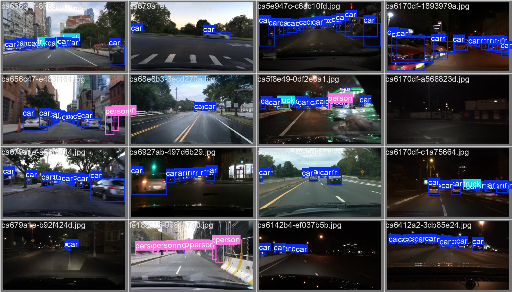
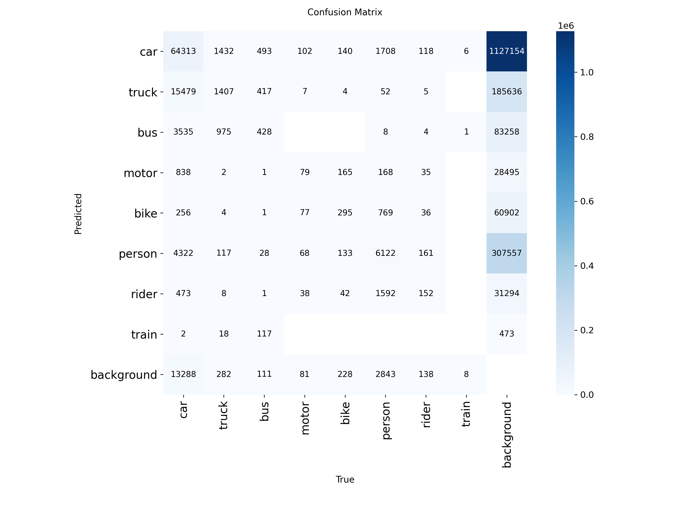

# BDD100K Object Detection with YOLOv8

تشخیص اشیای صحنه‌ی رانندگی (ماشین، عابر پیاده، چراغ راهنما و ...)
روی دیتاست BDD100K با YOLOv8.



## Results

| Metric | Value |
|---|---|
| mAP50 | 0.362  |
| mAP50-95 | 0.207 |
| Precision | 0.612 |
| Recall | 0.339 |

مدل با **۵ epoch و ۵۰٪ داده** آموزش دیده (به‌خاطر محدودیت GPU)،
پس نتایج یک baseline هستن.



## Setup

```bash
git clone https://github.com/USERNAME/bdd100k-yolo-detection.git
cd bdd100k-yolo-detection
pip install -r requirements.txt
```

## Data

دیتاست از کگل دانلود می‌شه (داخل ریپو نیست):

```python
import kagglehub
path = kagglehub.dataset_download("marquis03/bdd100k")
```

سپس لیبل‌ها به فرمت YOLO تبدیل می‌شن:
`python src/prepare_data.py`

## Usage

```bash
python src/train.py              # آموزش
python src/evaluate.py           # ارزیابی
python src/predict.py img.jpg    # پیش‌بینی روی یه عکس
python src/export.py             # خروجی ONNX
```

مدل آماده‌ی ONNX: `weights/best.onnx`

## Training Details

- Model: YOLOv8n
- Epochs: 5، Image size: 640، Batch: 16
- Data fraction: 0.5
- Environment: Google Colab

## Limitations

- آموزش کوتاه؛ کلاس‌های نادر ضعیف‌ان
- روی تصاویر شب و باران دقت پایین‌تره

## Future Work

- آموزش کامل با epoch بیشتر و مدل بزرگ‌تر
- augmentation برای شب و باران
- ردیابی (tracking) روی ویدیو
